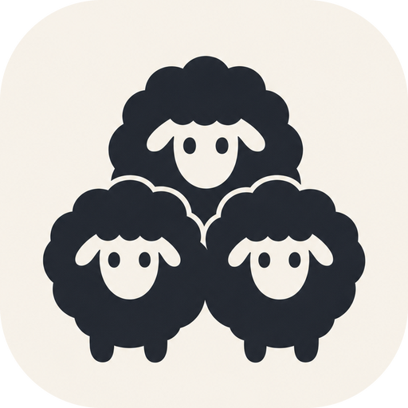
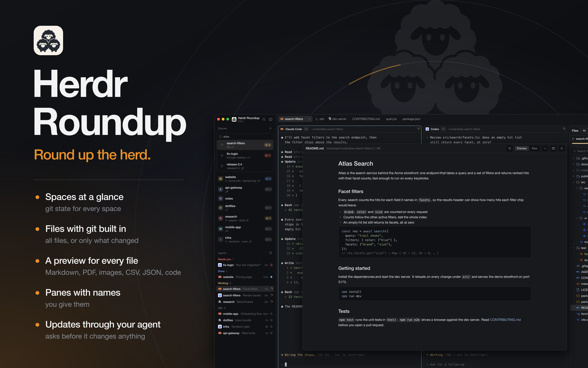

<p align="center"></p>

# Herdr Roundup

<p align="center"><a href="https://carstenlucke.github.io/herdr-roundup/"><b>→ See every feature, with pictures, on the project page</b></a></p>

A layout for [Herdr App](https://herdr.dev), started from Herdr's default layout (`main`, Herdr 0.1.13).

The layout is called `Herdr-Roundup`: Herdr's Settings show a layout by its file name, and a name with a space can't be switched to. Its mods keep the short `roundup-` prefix.

[](https://carstenlucke.github.io/herdr-roundup/)

## Contents

| Path | What |
| --- | --- |
| `layouts/Herdr-Roundup.json` | The window: its tree of rows, columns, stacks and blocks, and its look |
| `mods/roundup-*/` | The layout's own mods. Until a mod is cloned here, the layout uses Herdr's shipped ones (`agents`, `changes`, `workspace-status`). The side panel's file list is `roundup-files`, in place of Herdr's `files`; a double-click on a file shows it in `roundup-preview`'s floating window, a Cmd-double-click in a tab of its own (Markdown, PDF, images, CSV/TSV, JSON, code) |
| `themes/` | Themes. One named `Herdr-Roundup.json` is the layout's own: Settings offers it only there |
| `keys.json` | The `layout:Herdr-Roundup` section: keys that apply only while this layout shows |
| `assets/` | Files for this README, such as the logo |
| `docs/ARCHITECTURE_DECISIONS.md` | The few decisions whose reasons need keeping, and when to write one: an index, details in `docs/adr/` |
| `docs/GITHUB_PAGES.md` | How the project page is made and published |
| `scripts/sync.sh` | Installs all of the above into `~/.config/herdr-app` |
| `site/` | The project's web page (GitHub Pages): `index.html`, `style.css` and its pictures in `site/img/` |
| `scripts/preview.py` | Draws the layout's preview picture for Settings, with `poster` README's `preview.png`, and with a scene name the site's pictures |
| `scripts/site.sh` | Redraws `site/img/` (needs `python3`, `rsvg-convert`, `cwebp` and Herdr App installed) |
| `.github/workflows/pages.yml` | Publishes `site/` to GitHub Pages, only when run by hand |
| `scripts/build-icons.mjs` | Regenerates `roundup-files`' icons from a pinned release of Symbols (needs `curl`, `unzip`, Node) |
| `THIRD_PARTY_NOTICES.md` | Other people's work in this repo (icons, adapted code) and their licences |

## Install

Tell your agent:

```text
Read ~/.config/herdr-app/AGENTS.md, then add this layout: https://github.com/carstenlucke/herdr-roundup/tree/main
```

Or, from a clone of this repo:

```sh
scripts/sync.sh
herdr-app do layout.switch '{"name":"Herdr-Roundup"}'
```

`sync.sh` copies the layout, the `roundup-*` mods and the themes (copies, not symlinks: Herdr App doesn't load a mod's own SVGs through a symlink), and replaces only the `layout:Herdr-Roundup` section of your `keys.json`. Sizes, hidden columns and theme picks you change by clicking stay in `layouts/.state/`.

## Updates

The version you have is under the name at the top left. Once a day the layout asks GitHub whether there is a newer release: a plain `GET` to `api.github.com` with a generic User-Agent, so GitHub sees nothing but your IP. A new version shows as a point on the logo, `0.8.0 available` under the name and one notification.

Click the logo or the name for the menu: check now, update, read the release notes, skip a version, or choose "Only when I ask" to stop the daily check. Updating opens a tab with your agent and a brief: it reads the release, tells you what would change (keys or mods you edited yourself included) and asks before it installs anything.

## Working on it

- Herdr reloads a mod or layout on every save. After editing, run `scripts/sync.sh`.
- Tests: `node --test 'tests/*.test.mjs'` (Node 22.15 or later). CI runs the same on macOS for every pull request and push to `main`. What the suite covers: `tests/CATALOG.md`.
- To change one of Herdr's mods, clone it into this repo and point the layout at the clone:
  `herdr-app do mod.clone '{"name":"tabs","as":"roundup-tabs"}'`, move `~/.config/herdr-app/mods/roundup-tabs` into `mods/`, then set `"mod": "roundup-tabs"` in `layouts/Herdr-Roundup.json`.
- Mod folders carry the `roundup-` prefix: a folder's name is the mod's identity (layout blocks, `roundup-x.command` keys, `openOverlay`), and an install renames a mod whose name is taken.
- `scripts/smoke.sh` runs the L3 rows of `tests/CATALOG.md` in a second, isolated Herdr window (own home and core session; yours stays untouched): it comes to the front for about two minutes, prints ok/FAIL/SHOT per row and keeps the shots (`--offline` skips the GitHub check, `--help` for more).
- Reference: `~/.config/herdr-app/AGENTS.md` (layouts, mods, keys, settings) and `~/.config/herdr-app/herdr.d.ts` (the mod API). `herdr-app commands` lists every app command.

## License

Apache-2.0, see [LICENSE](LICENSE). Icons and code adapted from others are listed, with their licences, in [THIRD_PARTY_NOTICES.md](THIRD_PARTY_NOTICES.md).
