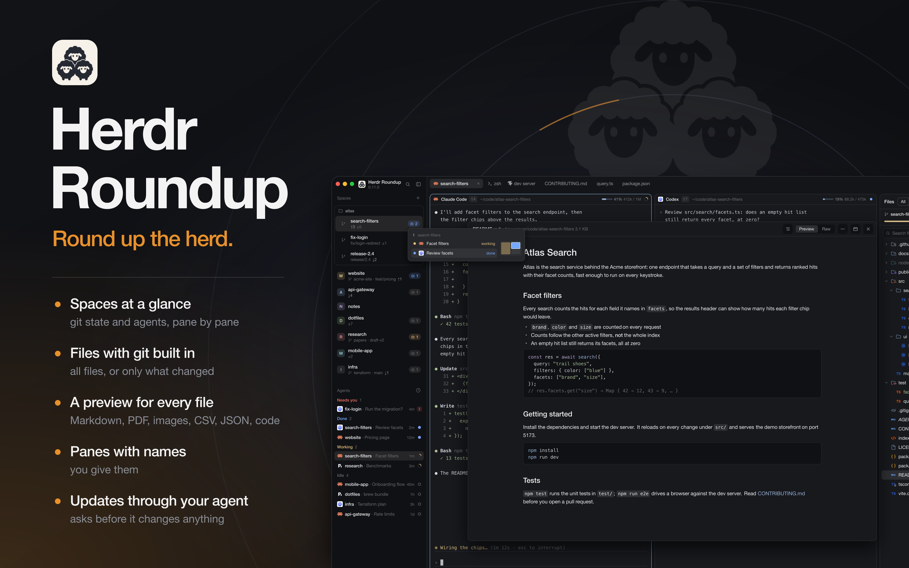

# Herdr Roundup 0.11.0-beta.4

Fourth beta of 0.11.0: the layout is brought up to Herdr 0.1.18. Pane names are Herdr's own now, and the lists, the tab bar and the files panel take over what Herdr's shipped mods learned since 0.1.14. A pre-release, offered only with "Include pre-releases" ticked in the logo menu.

**Needs Herdr 0.1.17 or later.**

## Changed

- **Pane names are Herdr's.** Double-click a pane's name, click the pencil, or choose the new "Rename" at the top of the terminal's menu: Herdr asks in its own prompt and keeps the name with the pane, also after a restart. A preview pane can be named the same way. Names you gave before move over by themselves, a few seconds after their pane is shown.
- **Tabs:** a tab you didn't name follows its agent's title, as the agents list does. The bar scrolls to the active tab, and a touchpad swipe moves one tab at a time.
- **Spaces:** the active space stays in view. A name that starts with an emoji shows the emoji as its avatar. A repository kept as `project/.bare` is named after the project. A machine that needs a login shows the command to run, with Copy; one whose programs stop when you disconnect shows a warning.
- **Agents:** a title keeps its own emoji or bracket in front. A sub-agent you kept as a pane shows its own "done". The narrow rail marks the agent you are on.
- **Files and previews:** code is drawn in your terminal's font and size. The files panel reads nothing while Herdr is behind another app and catches up when it is back; after a slow read on a big repository it waits longer before the next.
- **Split down** has its own icon in the menus.

## Before you update

- Update Herdr first if it is older than 0.1.17: the pane's name, its menu and three mods use what only newer versions have.
- `scripts/sync.sh` replaces the layout, every `roundup-*` mod, the repo's themes and the `layout:Herdr-Roundup` section of `keys.json`. Global keys, other layouts and Herdr's own mods stay untouched.
- No new mods, no key changes. Every `roundup-*` mod changes except `roundup-confirm` and `roundup-workspace-chrome`, which only name the newer Herdr they are based on.
- The label `roundup-pane.name` on a terminal and the shared state `roundup-pane.names` are no longer where a pane's name lives. A pane header gives an old name to its pane and then removes it. From a script, name a pane with `herdr-app do pane.rename --pane <id> --name Build`; `hc label <terminal> roundup-pane.name=Build` only names a pane that has no name yet.
- A name now belongs to the pane, not the terminal: a terminal sent back to its parent and kept again starts unnamed.
- On macOS, File > Close Tab and Close Pane in the menu bar are Herdr's own (since Herdr 0.1.16) and close without asking, whatever "Ask before closing" says. The ×, the menus and the layout's keys ask.
- **To the updating agent:** nothing to set up. An integration already switched on stays on.
